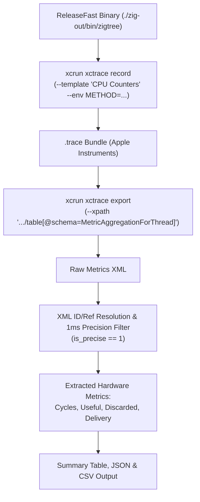

# Binary Tree Search Benchmarks

In this repository we implement and benchmark variants of binary tree search in Zig, comparing classical approaches against Niklaus Wirth's sentinel search and Arne Andersson's two-way search algorithm from his 1991 paper *"A Note on Searching in a Binary Search Tree"*.

The benchmark suite includes direct CLI execution, multi-iteration statistical analysis via Python, and low-level Apple Silicon hardware performance counter profiling (cycle counts, pipeline flushes, branch mispredictions, instruction delivery stalls) via Xcode Instruments (`xctrace`).

---

## Implemented Search Variants

1. **Standard Search (`member`)** ([`src/binary_tree_std.zig`](file:///Users/justinhj/projects/bst-blog/src/binary_tree_std.zig))
   - Classical textbook binary search.
   - Compares the search key against the current node's value (`<`, `>`, `==`), requiring up to two comparisons per node in the inner loop.
   - Exits early as soon as an exact match is discovered.

2. **Sentinel Search (`member`)** ([`src/binary_tree_sentinel.zig`](file:///Users/justinhj/projects/bst-blog/src/binary_tree_sentinel.zig))
   - Based on Niklaus Wirth's sentinel node technique (*Algorithms + Data Structures = Programs*, 1976).
   - All leaf pointers terminate at a single shared sentinel node rather than `null`.
   - Before traversal, the search key is written into the sentinel node (`sentinel.value = x`).
   - Traversal runs in a single loop condition `while (x != curr.value)` without checking for `null` pointers, cutting loop branches. After termination, a single check confirms whether the match was an interior node or the sentinel.

3. **Two-Way Search (`member2`)** ([`src/binary_tree_std.zig`](file:///Users/justinhj/projects/bst-blog/src/binary_tree_std.zig))
   - Implements Arne Andersson's 1991 two-way comparison method.
   - Defers equality testing until the search reaches a leaf:
     - If `x < curr.value`, moves left.
     - Else (`x >= curr.value`), records `curr.value` as the candidate match and moves right.
   - Executes only **one comparison per node** inside the traversal loop. When the leaf is reached, it performs a single equality check (`candidate == x`).
   - Highly effective on shallow/balanced trees where branch prediction and instruction pipelining dominate.

4. **Three-Way Search (`member3`)** ([`src/binary_tree_std.zig`](file:///Users/justinhj/projects/bst-blog/src/binary_tree_std.zig))
   - Explicit three-way comparison using `std.math.order(x, curr.value)` and a `switch` statement.

---

## Building and Testing

Prerequisites: [Zig](https://ziglang.org/) (0.17.0 recommended, manageable via [`mise`](file:///Users/justinhj/projects/bst-blog/mise.toml)).

```bash
# Build debug binary
zig build

# Build optimized release binary
zig build -Doptimize=ReleaseFast

# Run unit tests
zig build test
```

---

## Running Benchmarks Directly via Zig

The compiled binary (`zig-out/bin/zigtree`) benchmarks searches against a generated tree using a fixed PRNG seed for deterministic runs. Results display execution time in nanoseconds per lookup (`ns/op`), total runtime in microseconds (`us`), and an accumulator hash (`Hash: 0x...`) which prevents compiler dead-code elimination and validates correctness across methods.

### Environment Variables

| Variable | Default | Description |
|---|---|---|
| `METHOD` | `all` | Search algorithm to run: `all`, `standard`, `sentinel`, `twoway`, or `threeway` |
| `BALANCED` | `0` | Tree structure: `0` for random unbalanced BST, `1` for balanced BST |
| `SUCCESSFUL_SEARCH` | `50` | Search hit percentage: `0` to `100` (`100` = all keys exist, `0` = all miss) |
| `NUM_ELEMENTS` | `100000` | Number of elements in the tree ($N$) |
| `NUM_ITERATIONS` | `10000` | Number of search queries to execute ($M$) |

### Examples

Run all algorithms on a default random tree:
```bash
zig build -Doptimize=ReleaseFast run
```

Run only Two-Way search on a balanced tree with 100% successful lookups:
```bash
BALANCED=1 SUCCESSFUL_SEARCH=100 METHOD=twoway NUM_ELEMENTS=5000 NUM_ITERATIONS=500000 zig build -Doptimize=ReleaseFast run
```

---

## Statistical Benchmarking (`run_benchmarks.py`)

[`run_benchmarks.py`](file:///Users/justinhj/projects/bst-blog/run_benchmarks.py) runs multiple iterations across a 4-scenario matrix ($N=5,000$ elements, $M=100,000$ lookups) and aggregates mean timings and standard deviations:

- Random Tree, Successful Search (`BALANCED=0`, `SUCCESSFUL_SEARCH=100`)
- Random Tree, Unsuccessful Search (`BALANCED=0`, `SUCCESSFUL_SEARCH=0`)
- Balanced Tree, Successful Search (`BALANCED=1`, `SUCCESSFUL_SEARCH=100`)
- Balanced Tree, Unsuccessful Search (`BALANCED=1`, `SUCCESSFUL_SEARCH=0`)

### Running

Using [`uv`](https://github.com/astral-sh/uv) (automatically resolves inline PEP 723 dependencies like `py-cpuinfo`):
```bash
uv run run_benchmarks.py
```

Or using standard `python3`:
```bash
python3 run_benchmarks.py
```

Sample output:
```text
=== BENCHMARK SUMMARY (10 runs, N=5000, M=100000) ===

--- Balanced Tree, Successful Search ---
  Standard  Search: Mean =    60.48 ns/op, StdDev =   1.07 ns/op (1.8%)
  Sentinel  Search: Mean =    37.95 ns/op, StdDev =   0.53 ns/op (1.4%)
  Two-Way   Search: Mean =    30.34 ns/op, StdDev =   0.24 ns/op (0.8%)
  Three-Way Search: Mean =    58.31 ns/op, StdDev =   0.69 ns/op (1.2%)
```

---

## Hardware Profiling on macOS (`run_mac_benchmarks.py`)

[`run_mac_benchmarks.py`](file:///Users/justinhj/projects/bst-blog/run_mac_benchmarks.py) automates low-level hardware performance counter tracing on macOS (Apple Silicon) using Xcode command-line tools (`xcrun xctrace`).

### How Xcode Tools Calculate Cycle Counts and Metrics

Apple Silicon chips contain Performance Monitoring Units (PMUs) capable of recording core execution events. The script orchestrates `xctrace` to collect and parse these metrics:



#### 1. Method-Isolated Tracing (`xcrun xctrace record`)
To ensure counter readings reflect only the algorithm under test without pollution from tree creation or competing algorithms, the runner executes the binary in isolation by passing `METHOD=<variant>`:

```bash
xcrun xctrace record \
  --template 'CPU Counters' \
  --time-limit 30s \
  --output traces/balanced_hits_twoway.trace \
  --target-stdout traces/balanced_hits_twoway.out \
  --env BALANCED=1 \
  --env SUCCESSFUL_SEARCH=100 \
  --env METHOD=twoway \
  --env NUM_ELEMENTS=5000 \
  --env NUM_ITERATIONS=1000000 \
  --launch -- ./zig-out/bin/zigtree
```

#### 2. Thread-Level Metric Export (`xcrun xctrace export`)
The `.trace` package is queried for the `MetricAggregationForThread` schema via XPath:

```bash
xcrun xctrace export \
  --input traces/balanced_hits_twoway.trace \
  --xpath '/trace-toc/run[@number="1"]/data/table[@schema="MetricAggregationForThread"]'
```

#### 3. XML Dereferencing and Precision Filtering
The exported XML table uses node reference deduplication (`id` and `ref` attributes) and multi-resolution sampling intervals:
- **Reference Resolution**: Nodes with `ref="<id>"` are mapped back to their original definitions.
- **Precision Filter**: Row column 8 (`is-precise`) is inspected. Only precise 1ms sample intervals (`is-precise == 1` / `fmt="Yes"`) are aggregated. Coarse summary buckets are skipped to avoid double counting.

#### 4. Microarchitectural Counter Calculation
- **`cycles`**: Total hardware clock cycles elapsed during thread execution (sum of `metric-value-int` for `metric-name == "cycle"`).
- **`useful`**: Mean ratio of instruction retirement cycles representing useful computational work.
- **`discarded`**: Mean ratio of speculative execution cycles discarded due to branch mispredictions and pipeline clears.
- **`delivery`**: Mean ratio measuring frontend delivery bottlenecks (instruction cache misses, fetch/decode starvation).
- **`processing`**: Mean ratio measuring execution backend stalls.

### Running the macOS Suite

```bash
# Run full suite across all 4 scenarios and 4 search variants
uv run run_mac_benchmarks.py

# Customize tree size, iterations, and target scenario
uv run run_mac_benchmarks.py -n 5000 -i 500000 --combos balanced_hits --methods standard twoway

# Preview commands without running
uv run run_mac_benchmarks.py --dry-run

# Re-parse existing .trace files without re-running xctrace
uv run run_mac_benchmarks.py --export-only
```

### CLI Arguments for `run_mac_benchmarks.py`

| Flag | Default | Description |
|---|---|---|
| `-n`, `--elements` | `5000` | Tree node count |
| `-i`, `--iterations` | `1000000` | Search lookup iterations |
| `--combos` | `all` | Filter scenarios (`random_hits`, `random_misses`, `balanced_hits`, `balanced_misses`) |
| `--methods` | `all` | Filter algorithms (`standard`, `sentinel`, `twoway`, `threeway`) |
| `--time-limit` | `30s` | Maximum recording duration per run |
| `--traces-dir` | `traces` | Directory to save `.trace`, `.out`, `.xml`, JSON, and CSV artifacts |
| `--export-only` | `False` | Re-export and parse existing traces without re-recording |
| `--dry-run` | `False` | Print CLI invocations without executing them |

### Generated Tracing Artifacts

After running, the following files are produced in `traces/`:
- `traces/<scenario>_<variant>.trace`: Apple Instruments trace bundle (can be double-clicked to view interactively in the macOS Instruments GUI).
- `traces/<scenario>_<variant>.out`: Captured benchmark stdout containing `ns/op` timings and the validation hash.
- `traces/<scenario>_<variant>.xml`: Exported XML thread counters.
- `traces/mac_results.json`: Full structured benchmark and counter records.
- `traces/mac_results.csv`: Tabular CSV summary.

---

## Benchmark Observations (Apple Silicon M1 Pro)

| Scenario | Variant | ns/op | vs Standard | CPU Cycles | Useful | Discarded | Delivery |
|---|---|---|---|---|---|---|---|
| **Balanced Hits** | Standard Search | 73.32 | 1.00x | 108,229,789 | 0.266 | 0.753 | 0.928 |
| | Sentinel Search | 40.40 | 1.81x | 72,198,396 | 0.283 | 0.417 | 0.089 |
| | **Two-Way Search** | **31.06** | **2.36x** | **61,246,945** | **0.413** | **0.391** | **0.132** |
| | Three-Way Search | 64.59 | 1.14x | 106,209,375 | 0.274 | 0.849 | 0.948 |
| **Balanced Misses** | Standard Search | 78.78 | 1.00x | 113,347,368 | 0.229 | 0.785 | 0.998 |
| | **Sentinel Search** | **38.20** | **2.06x** | 69,086,894 | 0.494 | 0.521 | 0.223 |
| | **Two-Way Search** | 41.73 | 1.89x | **63,354,532** | 0.436 | 0.442 | 0.256 |
| | Three-Way Search | 65.47 | 1.20x | 115,891,890 | 0.377 | 0.869 | 1.115 |
| **Random Hits** | **Standard Search** | **57.46** | **1.00x** | 102,575,043 | 0.315 | 0.776 | 0.991 |
| | Sentinel Search | 79.66 | 0.72x | 125,623,824 | 0.198 | 0.324 | 0.086 |
| | Two-Way Search | 82.23 | 0.70x | 130,999,554 | 0.236 | 0.438 | 0.062 |
| | Three-Way Search | 66.32 | 0.87x | 102,106,201 | 0.262 | 0.730 | 0.956 |

### Architectural Takeaways

1. **Balanced Trees**:
   - **Two-Way Search** achieves a **2.36x speedup** on hits (**31.06 ns/op** vs 73.32 ns/op) and consumes nearly half the total cycles (**61.2M** vs 108.2M). Because it performs only a single comparison per node and defers equality checks to the end, the CPU pipeline avoids branch stalls and speculative flushes (discarded work drops from 0.753 to 0.391).
   - **Sentinel Search** excels on misses (**38.20 ns/op**, 2.06x speedup), dramatically lowering frontend delivery bottlenecks (0.089–0.223) by omitting `null` pointer branch checks in the loop.

2. **Random (Unbalanced) Trees**:
   - **Standard Search** performs best on hits (**57.46 ns/op**) because unbalanced trees have highly variable leaf depths; early exits upon hitting interior nodes frequently save significant traversal depth compared to Two-Way search, which always traverses to a leaf.

3. **Correctness Verification**:
   - The validation hash confirms that all four search variants visit identical trees and return identical search results across every test scenario.

---

## References

- Arne Andersson, *"A note on searching in a binary search tree"* (1991): [PDF](https://user.it.uu.se/~arneande/ps/searchproc.pdf)
- Niklaus Wirth, *"Algorithms + Data Structures = Programs"* (1976), Chapter 4: Dynamic Information Structures.
- matklad, *"Do Not Optimize Away"* (2025): [Article](https://matklad.github.io/2025/12/09/do-not-optimize-away.html)
